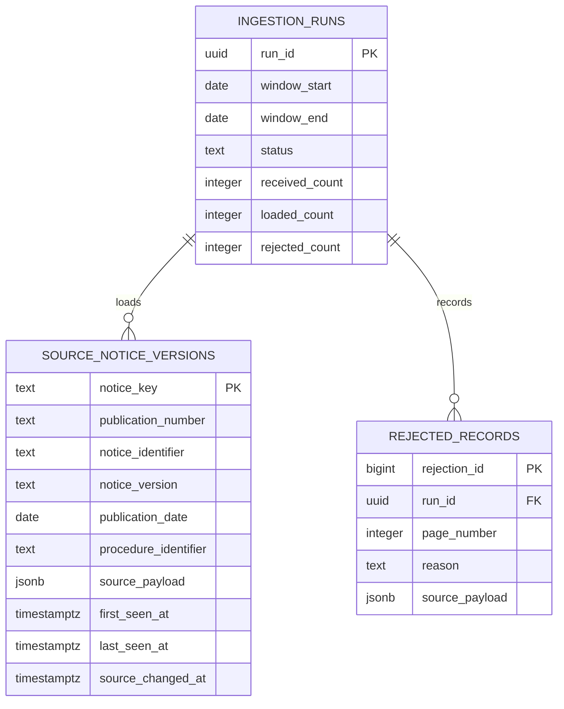

# Architektura

## Granice

ProcureScope jest batchową hurtownią, nie systemem czasu rzeczywistego. Źródłem prawdy
pozostaje TED. Aplikacja nie publikuje ani nie zmienia ogłoszeń.

    INGESTION_RUNS 1 -> wiele SOURCE_NOTICE_VERSIONS
    INGESTION_RUNS 1 -> wiele REJECTED_RECORDS

Przebieg przechodzi przez następujące etapy:

1. TedSearchClient wysyła zapytanie Expert Search do POST /v3/notices/search.
   Domyślny filtr wybiera daty publikacji, CPV 72* i miejsce realizacji POL.
2. Strony są pobierane trybem ITERATION. Limit pojedynczej strony nie przekracza
   250 ogłoszeń. Token iteracji jest sprawdzany pod kątem powtórzeń.
3. Odpowiedź HTTP jest zapisywana w Bronze. Obok pliku powstaje manifest ze
   źródłowym URL, zapytaniem, zakresem, numerem strony, czasem pobrania i SHA-256.
4. Parser zamienia wybrany podzbiór pól na kolumny. Wartości wielojęzyczne wybiera
   najpierw po polsku, a pełny obiekt wyniku pozostaje w source_payload.
5. Rekordy bez identyfikatora trafiają do rejected_records. Pozostałe trafiają do
   source_notice_versions przez INSERT ... ON CONFLICT.
6. Airflow po załadowaniu uruchamia dbt build, który buduje modele i wykonuje
   zadeklarowane przy nich kontrole jakości.
7. Metabase łączy się z PostgreSQL i udostępnia pytania SQL z katalogu metabase/.

## Historia i idempotencja

notice_key to SHA-256 identyfikatora źródłowego (preferowany notice-identifier,
następnie publication-number) oraz wersji, a gdy wersji brak — daty publikacji.
Klucz nie zastępuje identyfikatora TED; oba identyfikatory pozostają osobnymi
kolumnami. Powtórne pobranie tej samej wersji aktualizuje rekord, a nie tworzy
duplikatu.

last_seen_at zmienia się przy każdym odczycie rekordu z API. source_changed_at
zmienia się tylko wtedy, gdy suma kanonicznej odpowiedzi źródłowej jest inna. Dzięki
temu raport o zmianach nie traktuje samego codziennego odświeżenia jak korekty TED.

Każdy przebieg ma własny UUID. Pliki Bronze są partycjonowane po dacie pobrania,
identyfikatorze przebiegu i numerze strony. Nowy run nie nadpisuje poprzedniego.
Przebieg może mieć częściowe pliki Bronze i jednocześnie status failed; status
pełnego powodzenia jest ustawiany dopiero po przejściu po wszystkich stronach.

## Jakość i znaczenie

- Pusty termin lub wartość wyniku nie jest z automatu błędem.
- Wartości, waluty i części nie są sprowadzane do jednej sumy.
- award_fields zachowuje zestaw zwróconych pól wyniku w formie JSON. W pierwszej
  wersji nie dopasowujemy tablic wartości do części metodą indeksów.
- buyer_name jest opisem z ogłoszenia. Nie służy do budowania prawnej tożsamości
  zamawiającego.
- deadline przechowuje najwcześniejszy parsowalny termin z tablicy zwróconej przez
  Search API. To użyteczny filtr na poziomie ogłoszenia, ale nie zastępuje terminów
  modelowanych osobno dla każdej części.
- Błąd normalizacji nie usuwa źródła: rekord pozostaje w Bronze i w kwarantannie.
- Odpowiedź oznaczona przez TED jako timed out zachowuje się w Bronze i powoduje
  nieudany przebieg; częściowa strona nie jest raportowana jako pełny sukces.

## Dobór technologii

Wolumen i rytm publikacji wspierają dzienny batch. Kafka i Spark zostały pominięte,
bo nie ma pomiaru, który uzasadniałby ich koszt operacyjny. Jeżeli rozmiar historii
lub czas przetwarzania wzrośnie, decyzję o zmianie stosu poprzedzą metryki z
ingestion_runs.
